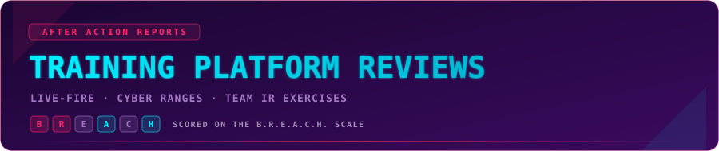

<p align="center">
  
</p>

<p align="center">
  
  
  
</p>

# Training Platform Reviews

Honest, spoiler-free reviews of live-fire exercises, cyber ranges and team incident response platforms, written from the defender's seat.

These reviews come from a team that has run at least 50 live-fire exercises across different platforms. Each review covers one session: what the platform does well, where it costs you time, and who it's actually for. Scenarios are never spoiled. You won't find attack techniques, tools or indicators from a scenario here, only how the exercise felt to play and what it trained.

> [!NOTE]
> These are personal opinions based on hands-on sessions. Training platforms change fast, so features, pricing and scenario lists may have moved on since a review was written. Check the details with the vendor before you buy.

Looking for certification reviews? Those live in a separate repo: [thm-cert-reviews](https://github.com/AnimSparrow/thm-cert-reviews), scored on the S.P.A.R.R.O.W. scale.

## Methodology: B.R.E.A.C.H. Score

A certification is something you study for and pass. A live-fire exercise is something you handle as a team, under time pressure, with real tools. B.R.E.A.C.H. measures what matters in the second case.

| Letter | Dimension | Definition |
|:---:|---|---|
| **B** | Believability | How real the environment, scenario and telemetry feel |
| **R** | Response mechanics | How investigation, containment and eradication actions work and are assessed |
| **E** | Ensemble | How well the platform supports teamwork and communication |
| **A** | Approachability | Onboarding, modes, tool choice and scenario availability |
| **C** | Closure | Quality and usefulness of the debrief and report |
| **H** | Hassle-free | Stability and day-to-day usability |

Each dimension is scored 1 to 10, with one plain-language sentence explaining the score.

### Weighting

| Tier | Multiplier | Dimensions |
|---|:---:|---|
| High | ×6 | Believability, Response mechanics |
| Medium | ×2 | Ensemble, Closure |
| Low | ×1 | Approachability, Hassle-free |

```
overall = (Σ score × weight) / 18
```

Believability and Response carry the most weight because they decide whether the exercise trains real skills. Teamwork and the debrief come next: a good session is a team effort, and a good report is what you learn from afterwards. Onboarding and stability matter, but they are the least decisive. The tiers are the same as in S.P.A.R.R.O.W., so scores across both series read the same way.

There is no value-for-money dimension. Most of these platforms are sold to organisations on custom or plan-based pricing, so a price score wouldn't mean much to most readers.

## All Reviews

| Platform | Review type | Date | Score |
|---|---|---|:---:|
| TryHackMe Live Breach | [First Impression](reviews/01-tryhackme-live-breach-first-impression.md) | Oct 2026 | **8.67** |

More reviews coming soon.

**Review types:**
- **First Impression:** one session, what stood out and what got in the way.
- **Deep Dive:** a closer look after more time on the platform, with more detail on specific features.

## Repo Structure

```
training-platform-reviews/
├── README.md                                        ← you are here
├── assets/
│   ├── hero-banner.svg, more_reviews.svg            ← shared
│   └── NN-<platform>-<review-type>-banner.svg       ← per review, plus -scorecard.svg
└── reviews/
    └── NN-<platform>-<review-type>.md               ← one file per review, numbered in order
```

---

<p align="center">
  <a href="https://www.linkedin.com/in/animsparrow">
    
  </a>
  <a href="https://tryhackme.com/p/Animsparrow">
    
  </a>
  <a href="https://www.credly.com/users/karol-wroblewski.65e1a9b0/badges">
    
  </a>
</p>
