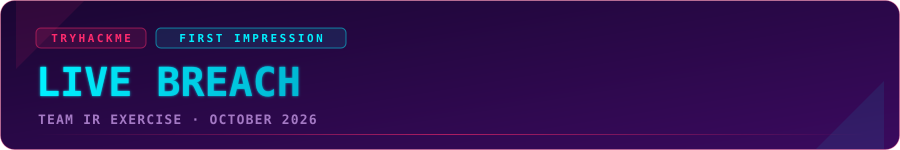
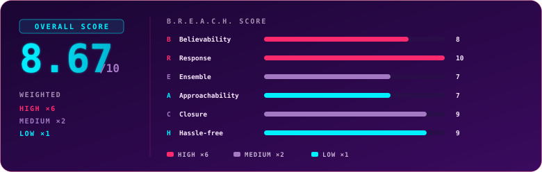
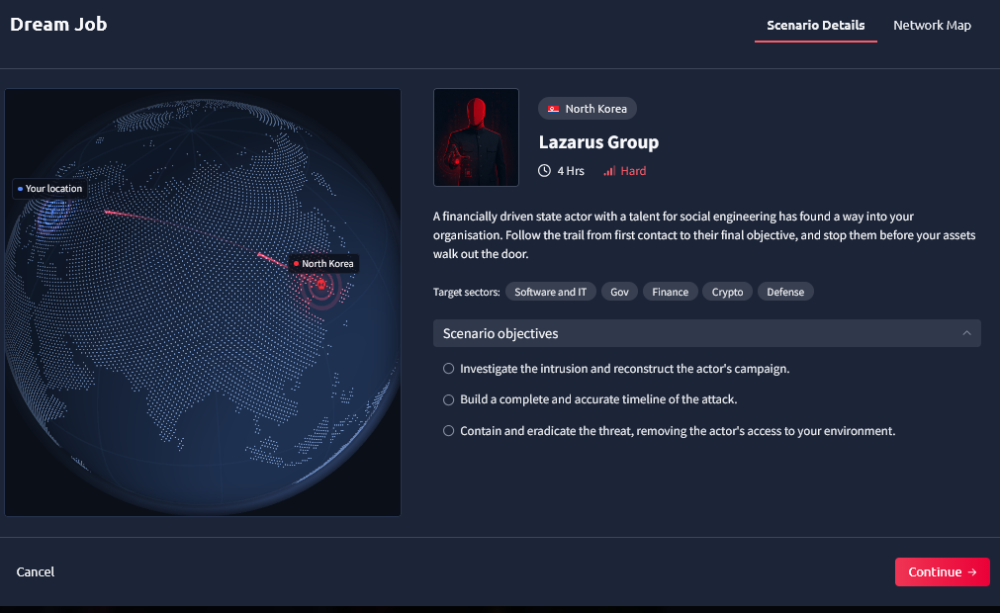
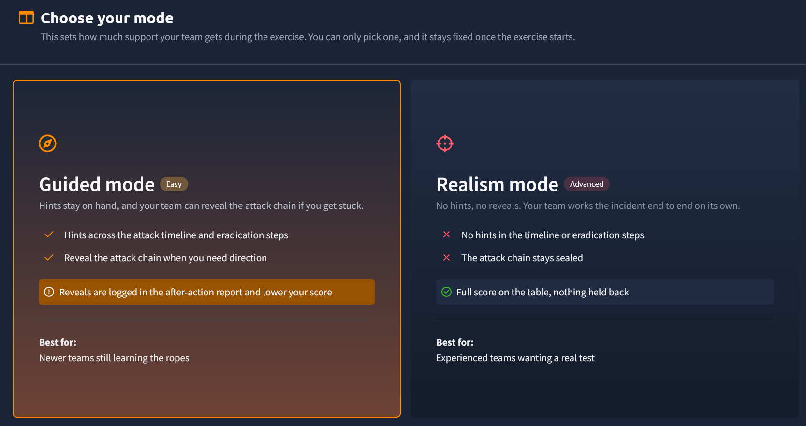
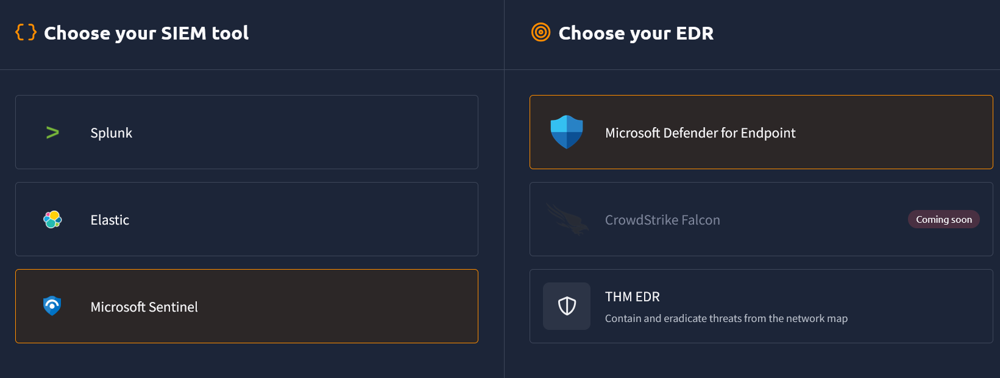
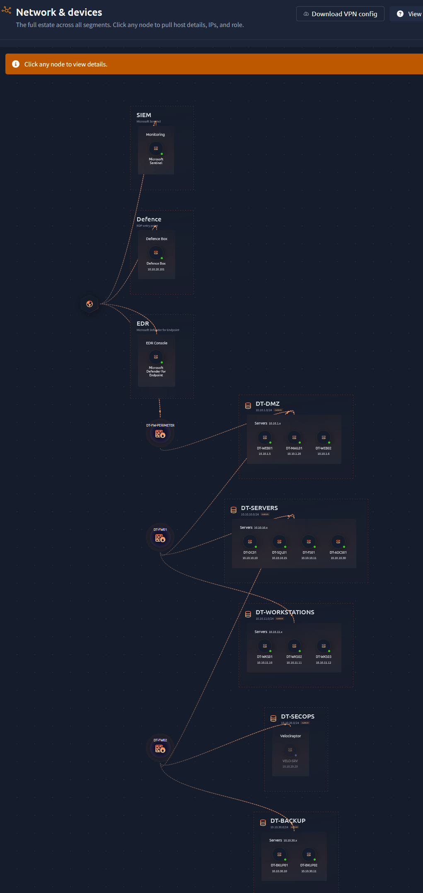
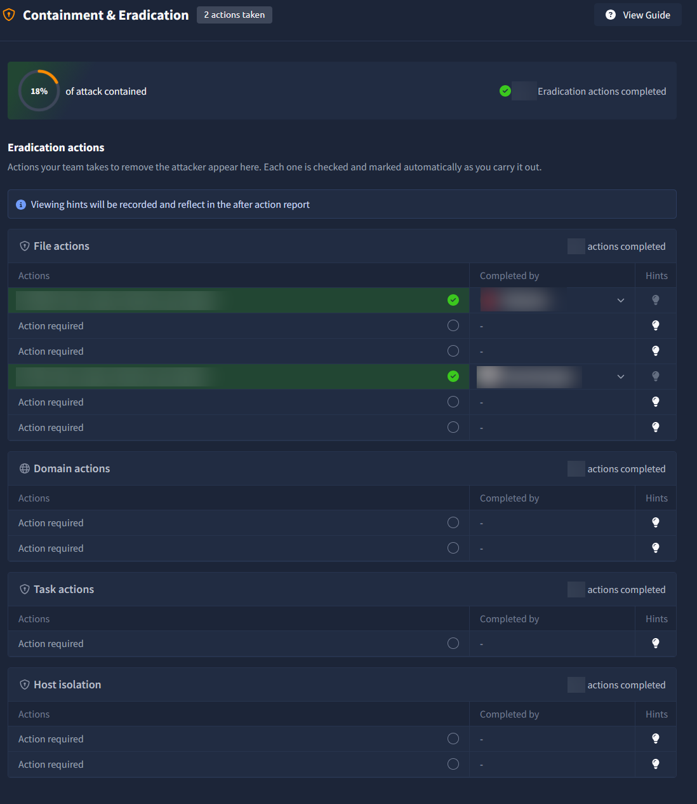
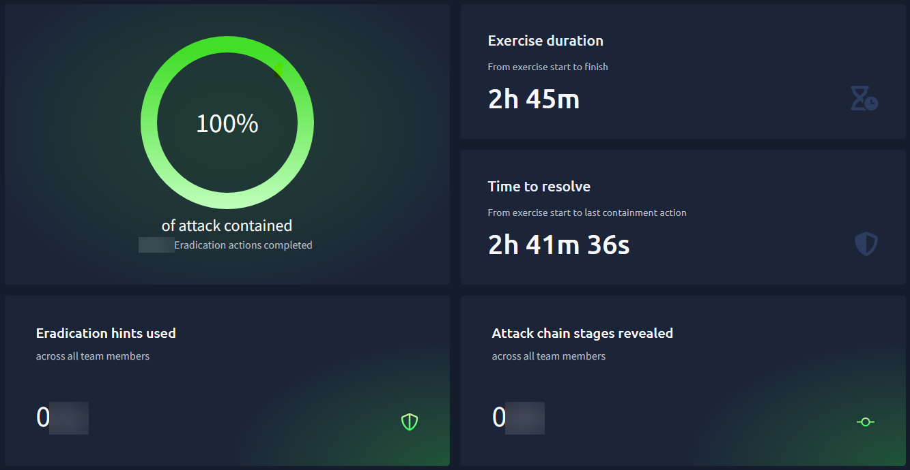

  

  
  
  

# Live Breach by TryHackMe: First Impression

> A team-based incident response exercise in a live, isolated corporate network. Six analysts, one attacker, four hours on the clock.

## Overview

> [!NOTE]
> **TL;DR:** Live Breach is the closest thing to a real incident I have seen on a training platform. You don't answer questions. You investigate, contain and eradicate, and the platform watches what you actually do. Our team contained 100% of the attack with max/max eradication actions, 0/max hints and 0/max reveals, in 2h 45min out of 4h.

  

This review covers our first session, played in Guided mode. A follow-up review may come once the same team has run more scenarios in Realism mode.

## Exercise Parameters

| | |
|---|---|
| Product | TryHackMe Live Breach |
| Scenario | Dream Job |
| Difficulty | Hard |
| Default runtime | 4 hours |
| Mode | Guided (hints and attack-chain reveals available, logged in the report) |
| SIEM options | Splunk, Elastic, Microsoft Sentinel |
| EDR options | Microsoft Defender for Endpoint, THM EDR (CrowdStrike Falcon listed as coming soon) |
| Team size | Built for teams; we played with 6 |
| Spoilers | None. This review says nothing about the attack itself. |

> [!NOTE]
> **Access and pricing (information from TryHackMe):** Live Breach is available in the [Advanced Business plan](https://tryhackme.com/business/pricing), with unlimited runs and 4 custom exercises per year. For more details, I encourage you to contact TryHackMe directly. Because the price depends on the plan, this review has no value-for-money dimension.

## Background

Joanna Duffy and Dan Mayple from TryHackMe organised a session for a six-person team from my company, #TeamFresenius, so we could try out their new product: Live Breach exercises.

We had full freedom to pick the date, the scenario and how we approached it. After sharing our preferences, we went with Dan's suggestion: **Dream Job**, rated Hard, with a 4-hour runtime. Most of us had only used TryHackMe lightly, so we chose **Guided mode** to get a proper introduction. For tooling we picked **Microsoft Sentinel** as the SIEM and **Microsoft Defender for Endpoint** as the EDR.

We didn't come into this cold. As a group, we have at least 50 live-fire exercises behind us. Between us, our baseline includes platforms such as RangeForce, Immersive Labs and Cyberbit. So we know how these sessions usually run, where they tend to cut corners and what good looks like. That background shaped both how we approached Dream Job and how we judged Live Breach. When we say something stood out, it's in comparison with a fair number of similar exercises, not a first impression in the literal sense.

## Terrain

  

Before the clock starts, you choose three things:

- **The scenario:** each one is modelled on a real threat actor, with a difficulty level and a runtime.
- **The mode:** *Guided* (hints and attack-chain reveals are available, but they are logged and lower your score) or *Realism* (no hints, no reveals, full score on the table).

  

  
- **The toolset:** SIEM and EDR.

  

Then you land in a full corporate estate: several network segments, firewalls, servers, workstations, a backup zone and a security operations segment. Real telemetry flows into the SIEM and you have real access to the machines.

## Team Setup

We split roles before starting:

- **Incident commander (me):** assigned up front. I also naturally took over the shared timeline, and when someone added a finding without a time, I went back to the SIEM to pin it down.
- **Two host analysts:** each one owned one of the hosts we already knew were involved, and dug through it end to end.
- **One log analyst:** lived in the SIEM and answered questions from everyone else.
- **Two floaters:** went wherever the findings pointed next, chasing leads across other hosts.

For a team of five or six this worked well. Nobody was idle, and nobody was duplicating someone else's work.

## Mission Debrief

**The network map is the centrepiece.** It is interactive. It shows how traffic flows between segments, lets you click any host for its details, connect to it and take actions on it. You can also see which teammate is working on which host, which helps a lot with coordination.

  

**The shared timeline works like a team notebook.** Anyone can add a finding with a timestamp, host and description, and it syncs to everyone instantly, sorted by time.

**Your actions are detected automatically and instantly.** Delete a malicious file, disable an account or isolate a host, and the platform registers it as it happens. No "refresh detections" button and no "submit answer" step. Guided mode groups the expected actions into categories (files, accounts, persistence, host isolation), so you can see where you still have gaps without being told what they are.

  

**You can't brute-force your way through.** Many platforms in this space give you multiple-choice answers, so you can poke at options until something sticks. Here there is nothing to guess. You either find it and act on it, or you don't. That keeps analysts honest.

**There is more than one way to solve it.** You can act via remote desktop or directly on the device from the map. You can hunt in the SIEM or open Event Viewer on the host. The platform cares about the outcome, not the exact path.

**Our approach: act like it's real.** In exercises like this, teams often hold back containment until the end because they aren't sure what is being scored. We decided to treat it as a live incident: as soon as something was confirmed and documented, we blocked it or removed it. Judging by the result, that was the right call.

**The logs are very well designed.** The data tells a coherent story, with enough background noise that you have to separate signal from routine activity. The scenario is built on a real threat actor's tradecraft, and it never felt artificial.

## Friction Points

> [!WARNING]
> **Lab infrastructure looks like attacker activity.** A few artifacts belonging to the platform itself, such as a watchdog script running as a scheduled task to keep log shipping alive, sit on the hosts next to the real evidence. Nothing marks them as part of the lab, so an analyst has to stop, open them and confirm they are legitimate. It only takes a few minutes to rule them out, but in a timed exercise those minutes add up, and with six people it can happen more than once. A simple naming convention or tag, something like "TryHackMe: do not delete", or a short list in the scope notes would remove that noise without making the scenario any easier.

- **Too many communication channels.** The built-in team chat needs its own window, so you either keep it open on the side or keep jumping back to it. Add a call with TryHackMe staff (when the session is run together with them) and your own team's channel in Teams, and you end up juggling three places to talk. A collapsible pop-up chat in the corner, similar to Echo on TryHackMe or a standard support chat widget, would let you drop a message without leaving your investigation, and might make the other channels unnecessary.
- **The scenario library is still small.** Other platforms we've used offer many more scenarios. Live Breach has only a handful for now, which limits repeat value today. According to TryHackMe, they are building the library out with at least one new scenario per month, and in the meantime custom exercise requests help fill the gap. For details, I encourage you to contact TryHackMe directly.

That's it. The platform itself ran without a single hiccup for the whole session.

## The After-Action Report

This deserves its own section. When you finish, you get a detailed report that includes:

- the full **attacker path**, every stage mapped to MITRE ATT&CK,
- your **containment and eradication** results, with timings per category,
- every **timeline submission**, credited to its author,
- an **activity timeline** showing when the team was investigating and when it was acting,
- an **AI-written analysis of gaps** in your timeline.

The gap analysis was the most valuable part. It pointed out one link in the attack chain that we had *inferred* rather than *proven*. It didn't change the outcome, but it was exactly the kind of feedback a senior analyst would give you in a real post-incident review.

## B.R.E.A.C.H. Score

S.P.A.R.R.O.W. is built for certifications, so it doesn't fit a team exercise. B.R.E.A.C.H. keeps the same weighting logic but measures what matters in a live incident simulation. Full definitions are in the [methodology](../Readme.md#methodology-breach-score).

| | Dimension | Weight | Score | Why |
|:---:|---|:---:|:---:|---|
| **B** | Believability | High ×6 | 8 | Built on a real threat actor, with coherent telemetry and realistic noise. A few lab artifacts break the illusion. |
| **R** | Response mechanics | High ×6 | 10 | Real actions, detected instantly, several valid paths, nothing to guess or brute-force. |
| **E** | Ensemble | Medium ×2 | 7 | The shared timeline and live map make teamwork natural, but the chat sits in its own window and you end up juggling several channels. |
| **A** | Approachability | Low ×1 | 7 | Guided mode and the tool choice make it easy to start. The scenario library is still small. |
| **C** | Closure | Medium ×2 | 9 | A detailed, honest report that caught a gap we missed. |
| **H** | Hassle-free | Low ×1 | 9 | Zero technical issues in a 2h 45min session. The chat is the only real usability snag. |

### Overall score: 8.67 / 10

| Tier | Weight | Scores | Weighted subtotal |
|---|:---:|---|:---:|
| High | ×6 | Believability 8, Response 10 → sum 18 | 108 |
| Medium | ×2 | Ensemble 7, Closure 9 → sum 16 | 32 |
| Low | ×1 | Approachability 7, Hassle-free 9 → sum 16 | 16 |

`(108 + 32 + 16) / 18 = 156 / 18 = 8.67`

> [!TIP]
> The two dimensions that matter most, Believability and Response, are where Live Breach is strongest. Everything that pulls the score down is about the experience around the exercise (chat, scenario count), not the exercise itself. Those are the easiest things to fix in a young product.

## Who Is This For?

- **SOC and IR teams** who want to practise as a team, not as individuals. The value is in coordination: who hunts, who contains, who documents.
- **Team leads and incident commanders** who want to see how their team performs under time pressure, and get an objective report afterwards.
- **Managers and L&D owners** looking for measurable training. You get time-to-contain, hint usage and a gap analysis instead of a quiz score.
- **Analysts moving from L1 to L2.** Guided mode is a safe way to experience an end-to-end incident, and Realism mode is the next step.
- **Less useful for:** solo learners without a team (it's built around collaboration), and complete beginners who haven't used a SIEM yet. Start with regular TryHackMe paths first.

## Verdict

Live Breach moves training from "answer the question" to "handle the incident". The automatic action detection, the shared timeline and the after-action report together create something we haven't seen elsewhere, and we have seen a fair amount. The main limits today are a small scenario library, a chat that doesn't fit the workflow and a few lab artifacts that cost time to rule out. None of them got in the way of a genuinely good session.

## Lessons Learned

- **Contain as you go.** Don't save containment for the end. Act once a finding is confirmed and documented.
- **Separate evidence from inference.** If two events line up in time, label the link as "likely" until you've proven it. The report will find it if you don't.
- **One person should own the timeline.** With six people adding findings, consistency and timestamps need a single owner.
- **Agree on one communication channel before you start.** Otherwise findings end up scattered across chats and calls.

## Our Result

  

| | |
|---|---|
| Attack contained | 100% |
| Eradication actions | max / max |
| Eradication hints used | 0 / max |
| Attack-chain stages revealed | 0 / max |
| Time used | 2h 45min of 4h |
| Timeline submissions | 19 |
| Overall feel | Real |

## What's Next

We plan to run more scenarios with the same team, this time in **Realism mode**. A follow-up review may follow.

## Methodology

**B**elievability · **R**esponse mechanics · **E**nsemble · **A**pproachability · **C**losure · **H**assle-free. Weights: High ×6 (B, R), Medium ×2 (E, C), Low ×1 (A, H).

Full definitions and the reasoning behind the weights are in the [B.R.E.A.C.H. methodology](../Readme.md#methodology-breach-score).

---

  

  
  
  

