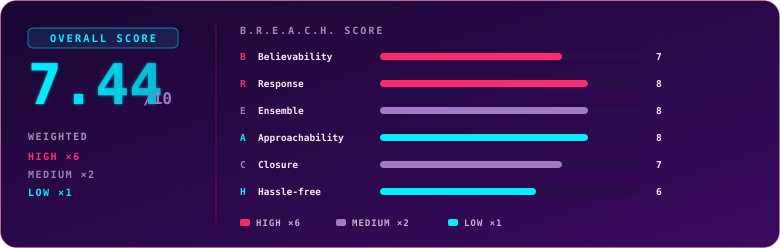
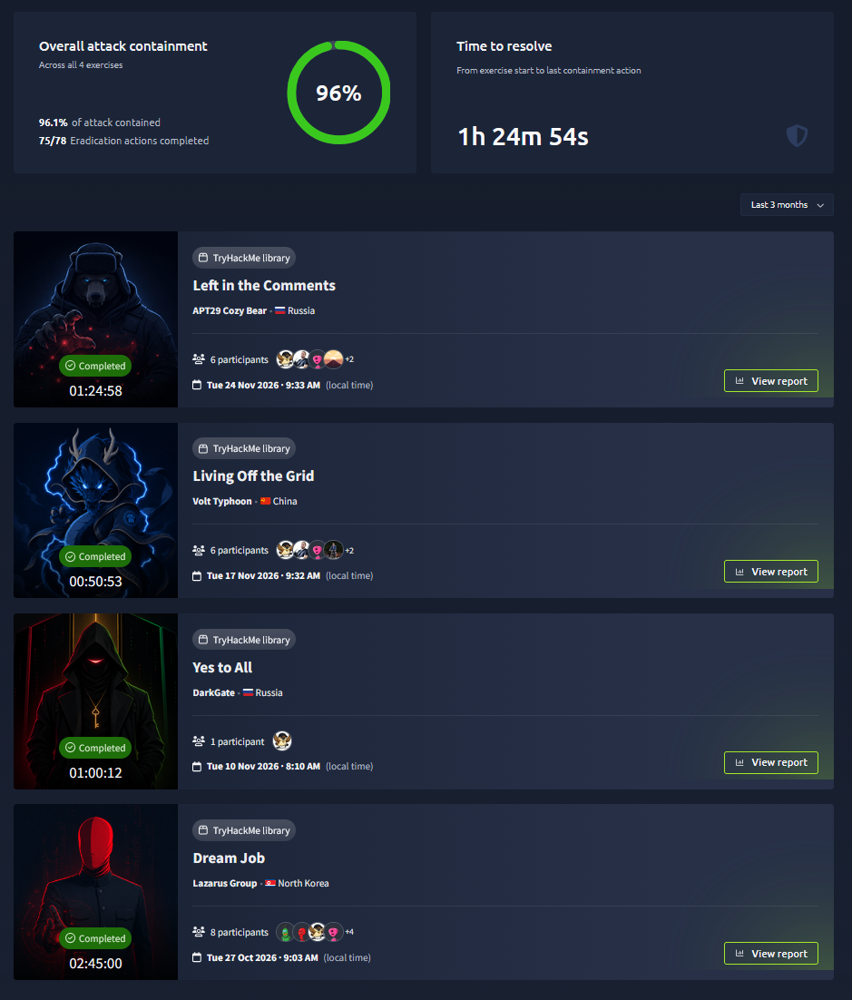
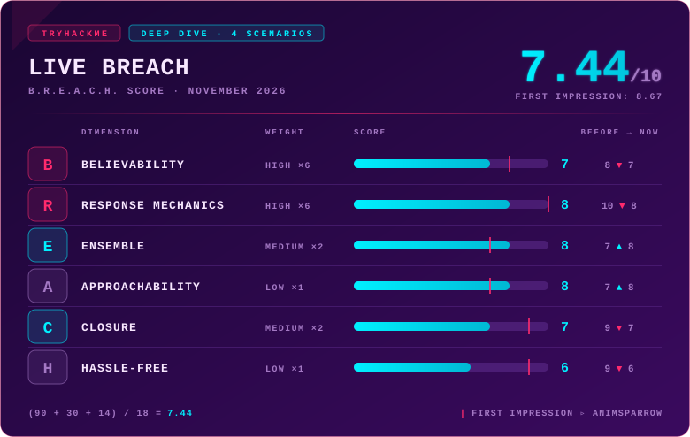

  

  
  
  

# Live Breach by TryHackMe: Deep Dive

> Four scenarios, two modes, teams of one, three and six analysts. One month on the platform.

## Overview

Our [First Impression](01-tryhackme-live-breach-first-impression.md) review covered our first session. Over the following month we ran every scenario available to us: four exercises in total, two in Guided mode and two in Realism mode, with a team of six, a solo run and two runs with three analysts. This review is the full picture: what holds up, what wears thin once you know the format, and what we'd like to see next.

> [!NOTE]
> **TL;DR:** Live Breach is a very good way to train SIEM investigation and team coordination on a realistic incident. After four scenarios, though, the pattern is clear: clean telemetry, investigations driven almost entirely by the SIEM, and a difficulty that is closer to Medium than Hard for an experienced team. We fully contained and eradicated the attack in all four exercises, with zero hints. The platform scored three of them at 100%. In the fourth, three deletions we had made were never registered, so it shows 84% (more on that [below](#friction-points)). We'd now like scenarios that push back: missing logs, more noise and something to reverse-engineer.

  

> [!NOTE]
> **No spoilers.** This review says nothing about attack techniques, tools or indicators from any scenario. Scenario names, threat actors and target sectors are taken from the public scenario cards.

> [!IMPORTANT]
> **Most of the bugs below are probably already fixed.** We reported every issue to TryHackMe support as we hit it, and fixes have typically followed within a few days. If you run Live Breach today, you will most likely not run into the problems described in Friction Points. We keep them in the review because they shaped our sessions, not because we expect you to hit them.

## The Four Sessions

| # | Scenario | Modelled on | Difficulty | Mode | Team | SIEM | Contained | Hints | Time used |
|:---:|---|---|:---:|:---:|:---:|:---:|:---:|:---:|:---:|
| 1 | Dream Job | Lazarus Group | Hard | Guided | 6 | Sentinel | 100% | 0 | 2h 45m / 4h |
| 2 | Yes to All | DarkGate | Medium | Guided | solo | Splunk | 100% | 0 | 1h 00m / 3h |
| 3 | Living Off the Grid | Volt Typhoon | Hard | **Realism** | 3 | Sentinel | 84% | 0 | 51m / 3h |
| 4 | Left in the Comments | APT29 (Cozy Bear) | Hard | **Realism** | 3 | Sentinel | 100% | 0 | 1h 25m / 3h |

Contained = share of the attack contained, as scored by the platform.

The 84% in session 3 does not reflect what we did. We were three actions short of the maximum only because three file deletions on one host were never registered by the platform, even though we confirmed the files were gone. See [Friction Points](#friction-points).

### Session by session

**1. Dream Job (Lazarus Group, Hard, Guided, 6 analysts).** Our first session and still the hardest of the four. It's the longest, has the most moving parts, and the attack spreads widely enough that six people really had something to do. It's also the session where coordination was hardest: with six analysts, keeping one shared timeline and one picture of the incident takes real effort. The [First Impression](01-tryhackme-live-breach-first-impression.md) review covers it in detail.

**2. Yes to All (DarkGate, Medium, Guided, solo).** A ransomware scenario I ran alone to see whether the format works for one person. It does: the full attack chain was clear in the SIEM within about 15 minutes, and the first eradication action landed 13 minutes after the start. The rest of the hour went into response, not investigation. There are many hosts and dozens of artefacts to clean up, and a Live Response bug (see Friction Points) slowed the clean-up down more than the attacker did. This scenario had no expected timeline in the report, so timeline submissions would not have been analysed anyway.

**3. Living Off the Grid (Volt Typhoon, Hard, Realism, 3 analysts).** The most realistic scenario of the four and our favourite. There is no malware to find and kill, only legitimate admin tools used the wrong way, which is exactly how this kind of intrusion looks in real life. The attacker also covers their tracks, which is a good lesson in why you never rely on a single log source. Once you understand the first host, the next ones go much faster. It was also the shortest session: 51 minutes for a Hard scenario.

**4. Left in the Comments (APT29, Hard, Realism, 3 analysts).** It starts from a vulnerability scanner finding and grows into a full domain incident. It's a clean, well-built chain that rewards careful SIEM work and patient scoping before containment. This is the session where we hit most of the RDP issues described below, and where the AI timeline review was least reliable.

## The Team

The core team stayed the same throughout: [Małgorzata Kędzierska (Megi)](https://www.linkedin.com/in/ma%C5%82gorzata-k%C4%99dzierska-825153280/), [Malcolm Kögler](https://www.linkedin.com/in/malcolm-k%C3%B6gler-27b8a9247/) and me. Only the first session had all six of us. For the two Realism sessions we invited the whole group again, but in the end the three of us played them, which turned out to be a useful experiment in itself (see "How many people do you need?").

As in the first review, we came in with a background of at least 50 live-fire exercises across other platforms, so our idea of "hard" is calibrated against that.

We usually split the work between us, especially during containment. In the last session, for example, Malcolm owned the accounts and one of the servers, Megi handled host isolation and the clean-up of credential-theft artefacts, and I worked the SIEM and wrote the timeline.

## What Holds Up

**Faithful threat actors.** Each scenario follows its actor's real playbook closely, from the first step to the objective. Nothing feels invented for the sake of a puzzle. You're investigating the kind of intrusion the actor is known for.

**Real response, assessed automatically.** You isolate hosts, disable accounts, delete files and remove persistence on live machines, and the platform registers each action as it happens. Nobody types an answer into a box. This is still the feature that sets Live Breach apart from most training platforms.

**Shadowing a live RDP session.** One person drives a machine and the rest of the team can watch the same session live. It turned out to be one of the best features for teamwork. Less experienced analysts learn by watching, the driver gets a second pair of eyes before running a destructive command, and nobody has to describe their screen over chat.

**Good choice of tooling.** Splunk, Sentinel and Elastic as SIEMs, and Microsoft Defender for Endpoint or TryHackMe's own EDR with a Live Response console. You can train on the stack you use at work. Across all four sessions the SIEMs and EDRs themselves worked very well: queries came back fast, and isolation and account actions took effect immediately.

**A detailed debrief.** The after-action report rebuilds the full attack chain mapped to MITRE ATT&CK, times every containment action, groups actions by type (accounts, files, tasks, isolation) and shows who did what. In Realism mode, seeing the full chain only at the end is genuinely satisfying. It's also the moment you find out what you missed.

**Realism mode does what it says.** No hints, no reveals. Interestingly, it didn't change much for us. We used zero hints in Guided mode too. For an experienced team, Realism mode is mostly a commitment, not a harder exercise.

## What Wears Thin

**Investigations are almost entirely SIEM work.** In all four scenarios the full attack chain could be rebuilt from the SIEM alone. Access to the hosts is used mainly to remediate, not to investigate. That makes Live Breach excellent SIEM training, but there is no memory forensics, no disk triage and no malware analysis. When a payload turns up, you only need to find it and delete it, not understand what it does. For a team that does DFIR for a living, that's the biggest missing piece.

**The environment is very clean.** Telemetry is complete, consistent and generous. Command lines are logged in full, every relevant host reports, and almost nothing is missing. A real estate is rarely like that. There is some lab noise (provisioning, monitoring agents, setup scripts), but after one or two sessions you recognise it immediately and it stops slowing you down. What's missing is the chaos of a real incident:

- gaps in logging and hosts that don't report at all,
- timestamps that don't line up between sources,
- a real volume of legitimate user and admin activity for the attacker to hide in,
- false leads that look malicious and aren't.

**"Hard" feels like Medium for an experienced team.** We finished both Realism-mode Hard scenarios in under half the allotted time, without hints and with three people. Dream Job was the most demanding of the four, mainly because of its length and the number of moving parts, not because any single step was hard to find.

**The scenario library didn't grow during our test.** In our first review, TryHackMe told us they planned at least one new scenario per month. We were hoping a new one would appear during our month of testing. As of 24 November 2026, when this review was written, nothing new had been added, and we had played everything available to us. For a team that wants to train regularly, repeat value is currently the main limitation.

## How many people do you need?

Our sessions covered all the options: one analyst, three and six.

- **Solo works**, at least for the Medium scenario. One experienced analyst finished in a third of the time. You lose the main point of the product, though, which is coordination.
- **Three is the sweet spot.** One person on the SIEM, one on the hosts with the others shadowing, and one owning the timeline and containment. Both Realism sessions with three people were faster than the Guided session with six.
- **Six is more than the scenarios need.** In Dream Job everyone contributed, but much of the work was coordination overhead. In shorter scenarios, extra people mostly watch.

These numbers count hands-on analysts only. If you bring an incident manager or commander who coordinates rather than investigates, add them on top. In our sessions I combined both roles, leading the response and investigating at the same time, but I like being a one-man army. Most teams will want a dedicated lead.

If you are a team lead, plan Live Breach for groups of three or four and run the same scenario with several groups, rather than putting the whole team into one session.

## Guided vs Realism

| | Guided | Realism |
|---|---|---|
| Hints | available, logged in the report | none |
| Attack-chain reveals | available, logged in the report | none |
| What changed for us | nothing, we used none | nothing, apart from the pressure |
| Who it's for | first session, less experienced teams | everyone after one Guided run |

Our time to the first containment action actually got longer in Realism mode (around 34 and 49 minutes, against 13 minutes in the solo Guided run). That was deliberate: with no reveals, we wanted the full scope before touching anything, so that the attacker couldn't move once we started. It paid off: in the last session every containment action was correct the first time.

  

## Friction Points

> [!NOTE]
> All of these were reported to TryHackMe support during or right after the sessions. Based on our experience so far, most will have been fixed within days.

- **RDP display artefacts.** In the last session several of us saw overlapping windows, black rectangles and half-drawn menus and UAC prompts in the browser RDP sessions. It made GUI tools such as Task Scheduler hard to use, and at times it was unclear which PowerShell window was actually elevated.
- **A disconnected RDP session does not come back.** If you disconnect (Start → Disconnect) or end the session, you can't reconnect to it, and even restarting the machine didn't help. Workarounds: reach the host from the Defence Box (the RDP entry point in the environment), or do the remaining work through the EDR's Live Response console.
- **Live Response refused some legitimate clean-up.** The console wouldn't delete scheduled tasks under `\Microsoft\Windows\` or some files under `C:\Windows`, and only let us disable the task. Attackers like hiding exactly there, so we finished the removal over RDP with `schtasks`, `takeown` and `icacls`. The error message ("may have taken effect anyway") also didn't say clearly what had happened. TryHackMe has confirmed this is a bug, not intended behaviour, and is fixing it.
- **Missed actions.** In Living Off the Grid, three deletions on one host were never registered, even though we checked on the host that the files were gone. That left us three actions short of the maximum and is the only reason one of our four results shows 84% instead of 100%.
- **Not the Sentinel you know from work.** The data sits in custom `_CL` tables with Windows event fields packed into a JSON column, instead of the native `SecurityEvent` or `Device*` tables, and the documentation lists Splunk-style sourcetypes. Each session starts with `getschema`, and a few common KQL constructs (such as `first` as a column alias) are rejected. Splunk, in our solo session, felt much closer to the real thing.
- **The debrief has gaps.** One scenario had no expected timeline, so our submissions weren't analysed. In another, the team-coordination analysis failed to generate. In the last session the AI timeline review called one of our entries an "invented" event, even though that exact event was in the logs. Our conclusion drawn from it was debatable, but the event itself was real. The analysis appears to compare our timeline against the expected scenario rather than against the telemetry the platform actually produced.

## B.R.E.A.C.H. Score

The First Impression review scored 8.67 after one session. This score covers all four.

  

| | Dimension | Weight | First Impression | Deep Dive | Why |
|:---:|---|:---:|:---:|:---:|---|
| **B** | Believability | High ×6 | 8 | **7** | Faithful threat actors, but the environment is too clean and the telemetry too generous to feel like a real incident. |
| **R** | Response mechanics | High ×6 | 10 | **8** | Still real actions on live hosts, but one scenario missed confirmed deletions and a Live Response bug forced workarounds over RDP. |
| **E** | Ensemble | Medium ×2 | 7 | **8** | Shadowing live RDP sessions makes collaboration natural. The coordination analysis didn't always generate. |
| **A** | Approachability | Low ×1 | 7 | **8** | Plenty of combinations: scenarios, three SIEMs, two EDRs, two modes and custom exercises. Not higher, because the library needs many more scenarios. |
| **C** | Closure | Medium ×2 | 9 | **7** | The attack chain mapped to MITRE is excellent, but the AI timeline review isn't always reliable and one scenario had none. |
| **H** | Hassle-free | Low ×1 | 9 | **6** | RDP artefacts and sessions that can't be resumed. Support responds quickly, which keeps it from going lower. |

### Overall score: 7.44 / 10

| Tier | Weight | Scores | Weighted subtotal |
|---|:---:|---|:---:|
| High | ×6 | Believability 7, Response 8 → sum 15 | 90 |
| Medium | ×2 | Ensemble 8, Closure 7 → sum 15 | 30 |
| Low | ×1 | Approachability 8, Hassle-free 6 → sum 14 | 14 |

`(90 + 30 + 14) / 18 = 134 / 18 = 7.44`

> [!TIP]
> The score went down not because the product got worse, but because four sessions show more than one. The core idea is still strong. What pulls it down is depth, variety and polish, and all three can be fixed. Polish is probably already being fixed.

## Who Is This For?

- **SOC teams that want to train SIEM investigation and coordination together.** This is where Live Breach is strongest.
- **Teams new to Sentinel, Splunk or Elastic.** A realistic incident is a much better way to learn a query language than a lab with one question per step.
- **Team leads** who want an objective report on how their team handles an incident: who did what, how fast, and what was missed.
- **Analysts moving from L1 to L2.** Start in Guided mode, then switch to Realism.
- **Less useful for:** experienced IR or DFIR teams looking for forensics, malware analysis or chaotic, incomplete data. It isn't there yet.

## What We'd Like to See

- **Scenarios with gaps:** hosts without an agent, a log source that stops mid-incident, rotated or partial logs.
- **More noise:** a real volume of legitimate user and admin activity, and false leads.
- **Depth beyond the SIEM:** memory images, disk artefacts, and a payload you have to analyse to understand what it did.
- **"Hard" that is actually hard,** or a level above it for teams that have outgrown the current scenarios.
- **A debrief built on the telemetry,** so that a real event in the logs is never flagged as invented.
- **New scenarios at a steady pace,** as announced, so that teams can train every month.

## Lessons Learned

- **Learn the SIEM schema first.** Two minutes of `getschema` or a field summary saves twenty minutes of failed queries.
- **Plan for three people:** one on the SIEM, one on the hosts with others shadowing, one owning the timeline and containment.
- **Scope before you contain, then contain fast.** In Realism mode, a full picture first and a coordinated sweep afterwards worked better than acting on each finding.
- **Separate evidence from inference.** Either the report flags your inference, or it flags a real event as invented. Both are reasons to label every conclusion.
- **Check that each action registered.** Don't assume a deletion counted just because the file is gone.
- **Report bugs as you go.** Support reacts quickly, and your report makes the next team's session better.

## Verdict

Live Breach is still the best team incident simulation we've used on TryHackMe, and one of the better ones overall. It trains exactly what it promises: finding an intrusion in the SIEM, coordinating a response on live hosts and documenting it. After four scenarios and a month of use, though, our team has outgrown the current library. We hope the next scenarios are messier, deeper and harder, and that they arrive soon.

## Methodology

**B**elievability · **R**esponse mechanics · **E**nsemble · **A**pproachability · **C**losure · **H**assle-free. Weights: High ×6 (B, R), Medium ×2 (E, C), Low ×1 (A, H).

Full definitions and the reasoning behind the weights are in the [B.R.E.A.C.H. methodology](../Readme.md#methodology-breach-score).

---

  

  
  
  

